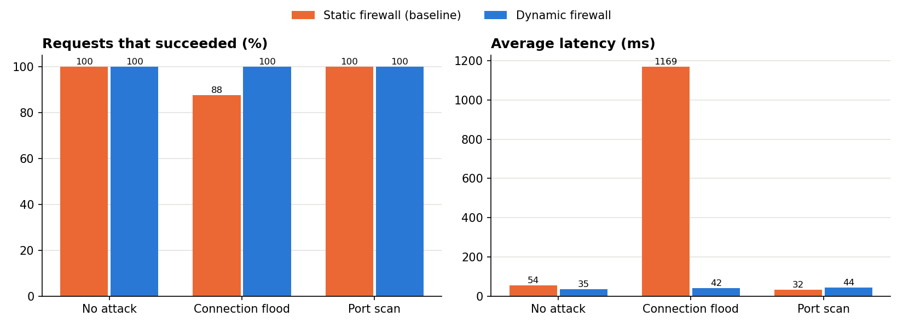
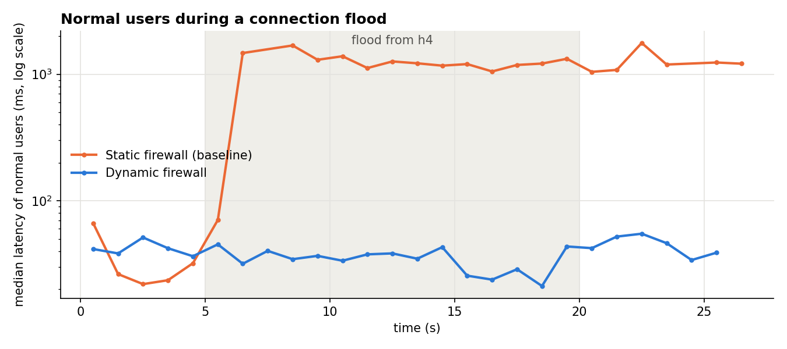
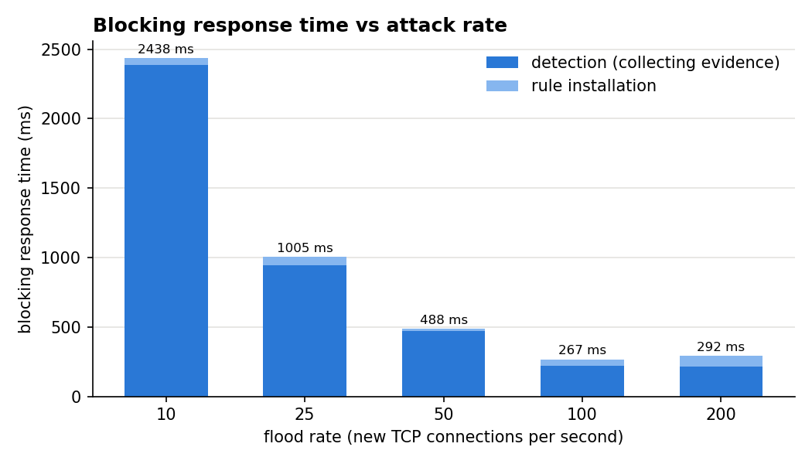

# Dynamic SDN Firewall with Centralized Security Event Logger

[](https://www.python.org/)
[](https://opennetworking.org/)
[-green.svg)](https://github.com/noxrepo/pox)
[](http://mininet.org/)
[](docs/results/report.md)

> **Computer Networks Mini-Project (Jackfruit)**  
> **Evaluation Rubric:** Deliverable 1 (15 Marks) + Deliverable 2 (25 Marks) = **Total 40 Marks**  
> **Key Focus:** Low-level TCP Socket Programming integrated with an OpenFlow Software-Defined Network (SDN).

---

## 📌 Executive Summary

Traditional static firewalls enforce pre-configured Access Control Lists (ACLs) based purely on static IP and port rules. Under volumetric threats—such as **TCP SYN connection floods** or **aggressive port scans**—static firewalls allow malicious traffic to saturate server sockets and choke bottleneck links.

This project implements an **autonomous, programmable security perimeter**:
1. **Dynamic SDN Control Plane:** A **POX OpenFlow 1.0 SDN controller** dynamically inspects and classifies every incoming TCP connection using low-level socket-derived packet-in events.
2. **Real-Time Anomaly Detection:** A **5-second sliding-window detector** tracks connection frequencies and port distributions per source IP to detect connection flooding, port scanning, and persistent policy violations.
3. **Proactive Line-Rate Hardware Mitigation:** Upon detecting an attack, the controller installs high-priority (`priority=60000`) wildcard `DROP` rules directly into the **Open vSwitch (OVS)** data plane. The attacker is dropped at the switch ingress before malicious packets ever traverse the bottleneck link or touch the server operating system.
4. **Autonomous Recovery & Escalation:** Blocks expire automatically via switch-enforced `hard_timeout=20s`. Repeat offenders are penalized with exponential escalation ($20\text{ s} \to 40\text{ s} \to 80\text{ s} \to 160\text{ s}$).
5. **Centralized Auditing:** Every security event (`SWITCH_CONNECTED`, `DENY`, `BLOCK`, `BLOCK_ENFORCED`, `UNBLOCK`) is streamed asynchronously over an independent TCP socket channel to a **Centralized Security Event Logger** (listening on port 9999).

---

## 🏗️ Architecture & Topology

```
                  +-------------------------------------------------------+
                  |                 POX SDN CONTROLLER                    |
                  |             (controller/firewall.py)                  |
                  +---------------------------+---------------------------+
                                              | OpenFlow 1.0 (TCP :6633)
                                              | [PacketIn / FlowMod / Barrier]
                                              v
   +----------------------------------------------------------------------------------+
   |                             Open vSwitch s1 (Mininet)                            |
   |              Flow Table: Default PacketIn (0) + Hardware Drop (60000)            |
   +-----+--------------------+--------------------+--------------------+-----+-------+
         |                    |                    |                    |     |
         |                    |                    |                    |     | 10 Mbit/s Link
         |                    |                    |                    |     | (Bottleneck)
         v                    v                    v                    v     v
   +------------+       +------------+       +------------+       +------------+
   |  Host h1   |       |  Host h2   |       |  Host h3   |       | Server srv |
   | 10.0.0.1   |       | 10.0.0.2   |       | 10.0.0.3   |       | 10.0.0.100 |
   | (Admin)    |       | (Client)   |       | (Client)   |       | :8080 App  |
   +------------+       +------------+       +------------+       | :2222 Admin|
                                                                  +------------+
         |
   +-----+------+                                                 +------------+
   |  Host h4   |                                                 | Logger Host|
   | 10.0.0.4   |                                                 | 10.0.0.200 |
   | (Attacker) |                                                 | :9999 TCP  |
   +------------+                                                 +-----+------+
                                                                        ^
                                   Centralized Security Event Stream    |
                                   (JSON lines over TCP socket)---------+
```

---

## ⚡ Quick Start (Two Commands)

Run these inside the project folder on Ubuntu:

```bash
# 1. Full automated setup, 12 unit/system tests & 3-run benchmark (~20 mins)
bash scripts/run_everything.sh

# 2. Interactive live 3-pane demo for viva / evaluation
bash scripts/demo.sh
```

* `scripts/run_everything.sh`: Installs missing dependencies (`mininet`, `openvswitch-switch`, `tmux`, `python3-matplotlib`), runs 10 unit tests, 12 end-to-end Mininet checks, executes baseline vs dynamic benchmarks, and produces graphs in `docs/results/`.
* `scripts/demo.sh`: Opens a 3-pane `tmux` console:
  * **Top-Left:** Centralized Security Event Logger (`app/logger_server.py`)
  * **Top-Right:** Dynamic POX SDN Controller (`controller/firewall.py`)
  * **Bottom:** Mininet Guided CLI (`topology/demo.py`) — press **Enter** to step through 11 guided attack & defense scenarios!

---

## 📊 Live Measured Evaluation & Benchmark Results

The following results were measured directly from real TCP socket traffic across Open vSwitch in Mininet:

### Table 1: Normal Users (`h1`–`h3`) Under Attack: Static Baseline vs Dynamic SDN

| Traffic Condition | Firewall Mode | Legitimate Success % | Average Latency | Bottleneck Goodput | Attack Successes Allowed | Attacker Blocked After | Controller Packet-In Overhead |
|:---|:---|:---:|:---:|:---:|:---:|:---:|:---:|
| **No Attack** | Static Baseline | 100.0% | 54.4 ms | 1.92 Mbit/s | — | — | 1,672 |
| **No Attack** | Dynamic SDN | 100.0% | 35.1 ms | 1.92 Mbit/s | — | — | 1,757 |
| **Connection Flood** | **Static Baseline** | **87.5%** | **1,169.0 ms** | **0.37 Mbit/s** | **2,198** | *(Never Blocked)* | **5,149** |
| **Connection Flood** | **Dynamic SDN** | **100.0%** | **42.0 ms** | **1.91 Mbit/s** | **2** | **266.4 ms** | **1,831** |
| **Port Scan** | **Static Baseline** | 100.0% | 32.2 ms | 1.93 Mbit/s | 1 *(Port 8080 exposed)* | *(Never Blocked)* | 3,863 |
| **Port Scan** | **Dynamic SDN** | 100.0% | 44.0 ms | 1.93 Mbit/s | **0** *(No ports exposed)* | **71.4 ms** | **1,601** |

### Table 2: Reaction Time Scaling vs Attack Velocity (Dynamic Firewall)

$$\text{Total Blocking Reaction Time} = T_{\text{detection}} + T_{\text{rule\_installation}}$$

| Attack Rate (conn/s) | Anomaly Detection Delay ($T_{\text{detection}}$) | Hardware Rule Installation ($T_{\text{install}}$) | Total Response Time |
|:---:|:---:|:---:|:---:|
| **10 conn/s** | 2,389.5 ms | 48.0 ms | 2,437.5 ms |
| **25 conn/s** | 943.7 ms | 61.1 ms | 1,004.9 ms |
| **50 conn/s** | 470.3 ms | 18.0 ms | 488.3 ms |
| **100 conn/s** | 221.6 ms | 45.2 ms | 266.8 ms |
| **200 conn/s** | 215.7 ms | 76.0 ms | 291.7 ms |

---

## 📈 Performance Visualizations

### 1. Legitimate Client Protection (`fig1_normal_users.png`)
Under a connection flood, the static firewall suffers severe starvation: legitimate request success drops to **87.5%**, and latency spikes by **2,048%** (from 54.4 ms to 1,169.0 ms). The Dynamic SDN firewall maintains **100.0% success** and **42.0 ms latency**.

<p align="center">
  
</p>

### 2. Real-Time Latency Timeline During Attack (`fig2_flood_timeline.png`)
Shows legitimate user latency over a 30-second window. At $t = 5\text{ s}$, host `h4` begins flooding connections. In the static firewall (orange line), latency spikes above 1,000 ms and remains saturated. In the dynamic firewall (blue line), latency blips for 266 ms before returning to normal (~40 ms) as the hardware `DROP` rule takes effect.

<p align="center">
  
</p>

### 3. Response Time vs Attack Rate (`fig3_response_time.png`)
Shows that the dynamic firewall reacts faster as the threat becomes more severe: total response time plummets from **2,437.5 ms** down to **266.8 ms** because aggressive flooders hit the 25-connection detection threshold much faster.

<p align="center">
  
</p>

---

## 🛡️ Policy & Classification Engine

The policy is configured in `config/policy.json` and evaluated on a **first-match-wins** basis:

| Rule ID | Source IP | Destination IP | Destination Port | Protocol | Action | Traffic Class | Description |
|:---:|:---:|:---:|:---:|:---:|:---:|:---:|:---|
| **R1** | `10.0.0.1` | `10.0.0.100` | `2222` | TCP | `ALLOW` | `ADMIN` | Admin host granted management access. |
| **R2** | `any` | `10.0.0.100` | `2222` | TCP | `DENY` | `ADMIN` | All other hosts denied access to port 2222. |
| **R3** | `10.0.0.0/24` | `10.0.0.100` | `8080` | TCP | `ALLOW` | `SERVICE` | Subnet clients permitted to application service. |
| **R4** | `any` | `any` | `23` | TCP | `DENY` | `TELNET` | Legacy unencrypted Telnet dropped network-wide. |
| **Default** | `any` | `any` | `any` | Any | `ALLOW` | `OTHER` | Standard ARP, ICMP, and normal flows permitted. |

### Sliding-Window Thresholds
* **Connection Flood:** $\ge 25$ new TCP SYNs within 5 seconds $\to$ `CONN_FLOOD` block.
* **Port Scan:** $\ge 8$ distinct (destination, port) pairs within 5 seconds $\to$ `PORT_SCAN` block.
* **Policy Violations:** $\ge 5$ attempts stopped by `DENY` rules within 5 seconds $\to$ `POLICY_VIOLATION` block.

---

## 📂 Repository File Structure

```
SDN-Firewall-FINAL/
├── app/
│   ├── server.py              # Multi-threaded TCP server (ports 8080/2222, BoundedSemaphore)
│   ├── client.py              # TCP benchmark client (--parallel, --rate, --json)
│   └── logger_server.py       # Centralized security logger (TCP port 9999, .log & .jsonl)
├── config/
│   └── policy.json            # Firewall rules R1–R4, detection thresholds & block timeouts
├── controller/
│   ├── firewall.py            # POX OpenFlow 1.0 controller (PacketIn, drop rules, BarrierIn)
│   └── rules.py               # Policy matcher and sliding-window anomaly Detector
├── docs/
│   ├── PROJECT_REPORT.md      # Comprehensive 40-mark Jackfruit project report
│   ├── CODE_WALKTHROUGH.md    # In-depth file-by-file walkthrough with 23 viva Q&As
│   ├── DEMO.md                # 11-step interactive viva presentation script
│   └── results/               # Generated reports and publication-ready figures
├── experiments/
│   ├── run_experiments.py     # Automated benchmark suite (Static vs Dynamic comparison)
│   └── plot_results.py        # Generates fig1, fig2, fig3 and results.md
├── scripts/
│   ├── setup.sh               # One-time package installation
│   ├── start_controller.sh    # Starts POX firewall controller
│   ├── demo.sh                # 3-pane tmux live interactive demonstration
│   ├── run_everything.sh      # 1-command end-to-end execution
│   └── cleanup.sh             # Cleans Mininet leftovers and kills rogue processes
├── tests/
│   ├── test_rules.py          # 10 unit tests for Policy and Detector
│   └── system_check.py        # 12 end-to-end Mininet system validation tests
└── topology/
    ├── topo.py                # FirewallTopo (h1-h4, s1, srv, TCLink 10 Mbps bottleneck)
    └── demo.py                # Guided demo driver for demo.sh
```

---

## 👥 Team Work Division & Viva Specialization

| Member | Focus Area | Files Owned | Core Viva Competencies |
|---|---|---|---|
| **Member 1** | **TCP Sockets & Centralized Logging** | `app/server.py`<br>`app/client.py`<br>`app/logger_server.py` | TCP 3-way handshake, socket framing (`\n`), thread pool concurrency, `BoundedSemaphore(50)`, non-blocking event streaming to port 9999. |
| **Member 2** | **SDN Controller & Dynamic Defense** | `controller/firewall.py`<br>`controller/rules.py`<br>`config/policy.json` | POX OpenFlow 1.0 architecture, `PacketIn`, rule matching, 5s sliding window, `priority=60000` drop rules, `OFPFC_DELETE`, `BarrierRequest`, `FlowRemoved` recovery. |
| **Member 3** | **Mininet, Attacks & Benchmarking** | `topology/`<br>`traffic/attacker.py`<br>`tests/`<br>`experiments/` | Mininet virtual topology, OVS `s1` (`failMode='secure'`), 10 Mbps bottleneck emulation, SYN floods/port scans, baseline vs dynamic evaluation metrics. |

---

## 📄 License & Academic Integrity

Developed for the Computer Networks (SDN & Socket Programming) Mini Project. All implementations conform to academic evaluation rubrics.
