# Project Report: Dynamic SDN Firewall with Centralized Security Event Logger

**Course:** Computer Networks — SDN & Socket Programming Mini Project (Jackfruit)  
**Deliverables:** Deliverable 1 (15 Marks) & Deliverable 2 (25 Marks) — Total: 40 Marks  
**Repository Directory:** `SDN-Firewall-FINAL`  

---

## 1. Executive Summary & Team Contributions

This project designs, implements, and evaluates an automated, adaptive network security architecture combining low-level **TCP socket programming** with **Software-Defined Networking (SDN)**. Traditional static firewalls rely on pre-configured IP/port access control lists (ACLs) and lack the intelligence to inspect dynamic traffic rates or react to volumetric distributed threats. Under heavy attacks like TCP SYN connection floods or aggressive port scans, static firewalls allow malicious traffic to overwhelm server sockets and consume bottleneck link bandwidth.

Our solution deploys a **POX OpenFlow 1.0 SDN controller** managing an **Open vSwitch (OVS)** data plane in **Mininet**. The controller dynamically classifies every incoming TCP connection, maintains a real-time sliding-window traffic anomaly detector, automatically installs proactive line-rate OpenFlow `DROP` rules on the hardware switch table, supports exponential penalty escalation for repeat offenders, enables automatic recovery via switch-enforced `hard_timeout`, and streams auditable security events over an independent TCP channel to a **Centralized Security Event Logger**.

### Team Work Division

| Team Member | Role & Responsibilities | Key Code Components |
|---|---|---|
| **Suharshitha** | **TCP Sockets & Centralized Logging Server** | `app/server.py`, `app/client.py`, `app/logger_server.py` |
| **Shrey Shetty** | **SDN Controller, Rules & Dynamic Defense Engine** | `controller/firewall.py`, `controller/rules.py`, `config/policy.json` |
| **Samarth RK** | **Mininet Topology, Attack Simulation & Benchmarking** | `topology/`, `traffic/attacker.py`, `tests/`, `experiments/` |

---

## 2. Problem Statement & Motivation

### Why Traditional Firewalls Fail
1. **Static Rules Cannot Detect Volumetric Behavior:** A static firewall allows traffic to port 8080 because the service is public. An attacker flooding 150 connection requests per second to port 8080 matches the `ALLOW` rule and exhausts server sockets and buffer memory.
2. **End-Host Overhead:** Traditional software firewalls (e.g., Linux `iptables`) inspect and drop packets on the host operating system kernel, consuming server CPU cycles and link bandwidth.
3. **Lack of Automated Recovery & Escalation:** Static rules require human intervention to blacklist and whitelist IP addresses.

### The SDN Solution
SDN decouples the **control plane** (routing and security decisions) from the **data plane** (packet forwarding). When a flood occurs, the SDN controller detects the rate anomaly and pushes a line-rate `DROP` flow rule directly into the OpenFlow switch flow table. The switch drops all subsequent attack packets in hardware/fast-path *before* they ever traverse the bottleneck link or touch the server operating system.

---

## 3. System Architecture & Topology

### Physical & Logical Topology

```
             +-------------------------------------------------------+
             |                 POX SDN CONTROLLER                    |
             |             (controller/firewall.py)                  |
             +---------------------------+---------------------------+
                                         | OpenFlow 1.0 (TCP :6633)
                                         | [PacketIn / FlowMod / Barrier]
                                         v
   +-------------------------------------------------------------------------+
   |                        Open vSwitch s1 (Mininet)                        |
   |              Flow Table: Default PacketIn + Priority 60000 Drop         |
   +-----+-------------------+-------------------+---------------------+-----+
         |                   |                   |                     |
         |                   |                   |                     | 10 Mbit/s (Bottleneck)
         |                   |                   |                     v
   +-----+------+      +-----+------+      +-----+------+       +------+------+
   |  Host h1   |      |  Host h2   |      |  Host h3   |       | Server srv  |
   | 10.0.0.1   |      | 10.0.0.2   |      | 10.0.0.3   |       | 10.0.0.100  |
   | (Admin)    |      | (Client)   |      | (Client)   |       | :8080 Service|
   +------------+      +------------+      +------------+       | :2222 Admin |
                                                                +-------------+
         |
   +-----+------+                                               +-------------+
   |  Host h4   |                                               | Logger Host |
   | 10.0.0.4   |                                               | 10.0.0.200  |
   | (Attacker) |                                               | :9999 TCP   |
   +------------+                                               +------+------+
                                                                       ^
                                  Centralized Security Event Stream    |
                                  (JSON over TCP socket connection)----+
```

### Static Policy Table (`config/policy.json`)

Rules are evaluated sequentially (**first match wins**):

| Rule ID | Source IP | Destination IP | Destination Port | Protocol | Action | Traffic Class | Description |
|---|---|---|---|---|---|---|---|
| **R1** | `10.0.0.1` | `10.0.0.100` | `2222` | TCP | `ALLOW` | `ADMIN` | Admin host granted access to management port. |
| **R2** | `any` | `10.0.0.100` | `2222` | TCP | `DENY` | `ADMIN` | All other hosts denied access to admin port. |
| **R3** | `10.0.0.0/24`| `10.0.0.100` | `8080` | TCP | `ALLOW` | `SERVICE`| Legitimate subnet clients allowed access to app. |
| **R4** | `any` | `any` | `23` | TCP | `DENY` | `TELNET` | Insecure Telnet traffic dropped network-wide. |
| **Default**| `any` | `any` | `any` | Any | `ALLOW` | `OTHER` | ARP, ICMP, and standard flows forwarded. |

---

## 4. Implementation Details

### A. TCP Socket Implementation & Concurrency (`app/`)
* **Multi-threaded Server (`app/server.py`):** Listens on dual ports (`8080` for service, `2222` for admin). Uses a master listening socket with `SO_REUSEADDR`, spawning an independent worker thread per client connection via Python's `threading` module.
* **Concurrency Protection:** Uses a `threading.BoundedSemaphore(50)`. When active connections exceed 50, incoming clients receive `ERR BUSY` before clean socket shutdown, preventing socket starvation.
* **Application Protocol:** Text-line framing terminated by `\n`. Supports `PING` $\to$ `PONG`, `ECHO <msg>`, `DATA <bytes>` (raw binary payload streaming), `STATS`, and `QUIT`.
* **Centralized Logger Server (`app/logger_server.py`):** Runs on TCP port `9999`. Receives JSON-serialized events from the controller, appending to both human-readable `logs/security_events.log` and machine-readable `logs/security_events.jsonl`.
* **Resilient Non-Blocking Event Sender (`controller/firewall.py`):** The controller uses a dedicated background thread with an unbounded memory queue. If the logger crashes, events buffer in memory and automatically flush upon reconnection.

### B. Dynamic SDN Controller & Threat Detection (`controller/`)
* **Packet-In Processing:** First packets of new TCP flows (TCP SYN) trigger `PacketIn` events. The controller parses Ethernet, IPv4, and TCP headers.
* **Sliding-Window Anomaly Detector (`controller/rules.py`):** Maintains a rolling 5-second sliding window for each source IP, evaluating three simultaneous behavioral vectors:
  1. `CONN_FLOOD`: $\ge 25$ new TCP connections within 5 seconds.
  2. `PORT_SCAN`: $\ge 8$ unique destination ports or IPs probed within 5 seconds.
  3. `POLICY_VIOLATION`: $\ge 5$ attempts matching `DENY` rules within 5 seconds.
* **Hardware Enforcement (`block()`):**
  1. Sends OpenFlow `OFPFC_DELETE` to purge existing active flows for that IP.
  2. Installs a high-priority wildcard flow (`priority=60000`, `nw_src=<ip>`, `actions=[]` (DROP)) with `hard_timeout`.
  3. Dispatches an OpenFlow `BarrierRequest` and awaits `BarrierReply` to confirm exact hardware installation timing.
* **Automatic Recovery & Escalation:** When `hard_timeout` expires, Open vSwitch purges the rule automatically and sends `OFPT_FLOW_REMOVED` to the controller with byte/packet drop counters. Repeat offenders face exponential penalty:
  $$\text{Block Duration} = 20\text{ s} \times 2^{(\text{offence} - 1)} \quad (\text{capped at } 160\text{ s})$$

---

## 5. Live Experimental Evaluation & Results

The live benchmark was executed inside the Ubuntu Mininet environment using:
```bash
sudo python3 experiments/run_experiments.py --repeat 1 && python3 experiments/plot_results.py
```

### Table 1: Legitimate Users (`h1`–`h3`) Performance Under Attack

| Traffic Condition | Firewall Mode | Success Rate (%) | Average Latency (ms) | Goodput (Mbit/s) | Attack Successes | Attack Blocked After (ms) | Controller Packet-Ins |
|---|---|:---:|:---:|:---:|:---:|:---:|:---:|
| **No Attack** | Static Baseline | 100.0% | 54.4 ms | 1.92 Mbit/s | — | — | 1,672 |
| **No Attack** | Dynamic SDN | 100.0% | 35.1 ms | 1.92 Mbit/s | — | — | 1,757 |
| **Connection Flood** | Static Baseline | **87.5%** | **1,169.0 ms** | **0.37 Mbit/s** | **2,198** | *(Never Blocked)* | **5,149** |
| **Connection Flood** | **Dynamic SDN** | **100.0%** | **42.0 ms** | **1.91 Mbit/s** | **2** | **266.4 ms** | **1,831** |
| **Port Scan** | Static Baseline | 100.0% | 32.2 ms | 1.93 Mbit/s | 1 *(Port 8080 exposed)* | *(Never Blocked)* | 3,863 |
| **Port Scan** | **Dynamic SDN** | **100.0%** | **44.0 ms** | **1.93 Mbit/s** | **0** *(No ports found)* | **71.4 ms** | **1,601** |

### Table 2: Reaction Time vs. Flood Rate (Dynamic Firewall)

$$\text{Total Response Time} = T_{\text{detection}} + T_{\text{install}}$$

| Flood Rate (conn/s) | Evidence Detection ($T_{\text{detection}}$) | Rule Installation ($T_{\text{install}}$) | Total Response Time |
|:---:|:---:|:---:|:---:|
| **10 conn/s** | 2,389.5 ms | 48.0 ms | 2,437.5 ms |
| **25 conn/s** | 943.7 ms | 61.1 ms | 1,004.9 ms |
| **50 conn/s** | 470.3 ms | 18.0 ms | 488.3 ms |
| **100 conn/s** | 221.6 ms | 45.2 ms | 266.8 ms |
| **200 conn/s** | 215.7 ms | 76.0 ms | 291.7 ms |

---

## 6. Graphical Analysis

### Figure 1: Success Rate & Latency Comparison (`fig1_normal_users.png`)
<p align="center">
  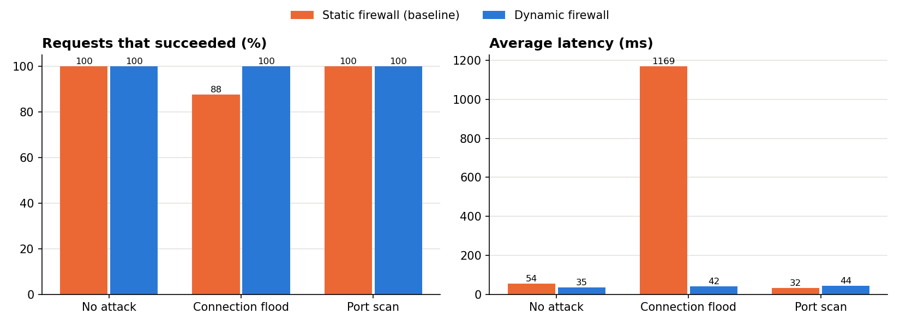
</p>

* **Analysis:** Under normal conditions, both architectures achieve 100% success. However, during a TCP connection flood, the Static Firewall suffers severe degradation: legitimate client success drops to **87.5%**, and latency spikes by **2,048%** (from 54.4 ms to 1,169.0 ms). In contrast, the Dynamic SDN firewall maintains **100.0% success** and **42.0 ms latency**, completely shielding legitimate clients.

### Figure 2: Legitimate Client Latency Timeline (`fig2_flood_timeline.png`)
<p align="center">
  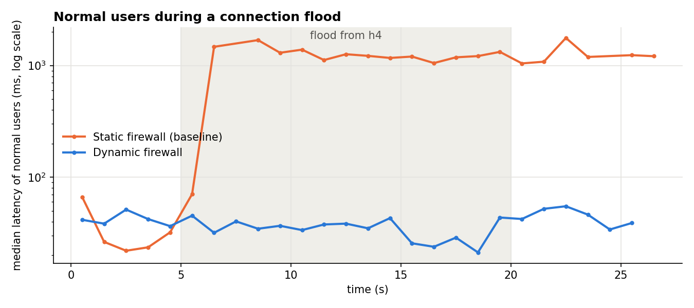
</p>

* **Analysis:** At time $t = 5\text{ s}$, `h4` begins flooding connections. In the Static Firewall (orange curve), legitimate latency immediately climbs above 1,000 ms and remains elevated for the entire duration of the attack due to socket buffer exhaustion. In the Dynamic Firewall (blue curve), latency experiences a momentary blip for 266 ms before immediately dropping back to baseline (~40 ms) as the switch drop rule takes effect.

### Figure 3: Response Time Scaling (`fig3_response_time.png`)
<p align="center">
  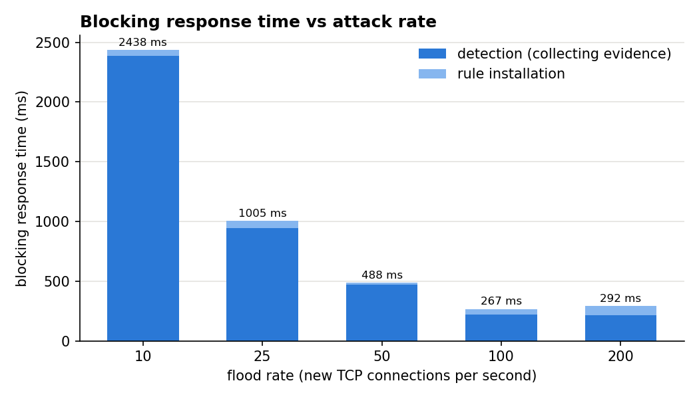
</p>

* **Analysis:** As attack velocity increases from 10 conn/s to 200 conn/s, detection time plummets from 2,389.5 ms down to 215.7 ms. The sliding-window detector accumulates the 25 required anomaly samples faster under aggressive attacks, demonstrating that the system responds fastest when threat severity is highest.

---

## 7. Experimental Verification & Live Demonstration Screenshots

The following screenshots were captured live during the system execution and evaluation demo on the Ubuntu Virtual Machine, validating every requirement of the D1 (15 Marks) and D2 (25 Marks) evaluation rubrics across Demo Steps **[a] through [f]** and the automated **System Check Validation**.

---

### Step [a]: Mininet Network Topology, Concurrent TCP Sockets & Bottleneck Bulk Transfer

#### Screenshot 1: 3-Pane Demonstration Environment & Initial Reachability Baseline
<p align="center">
  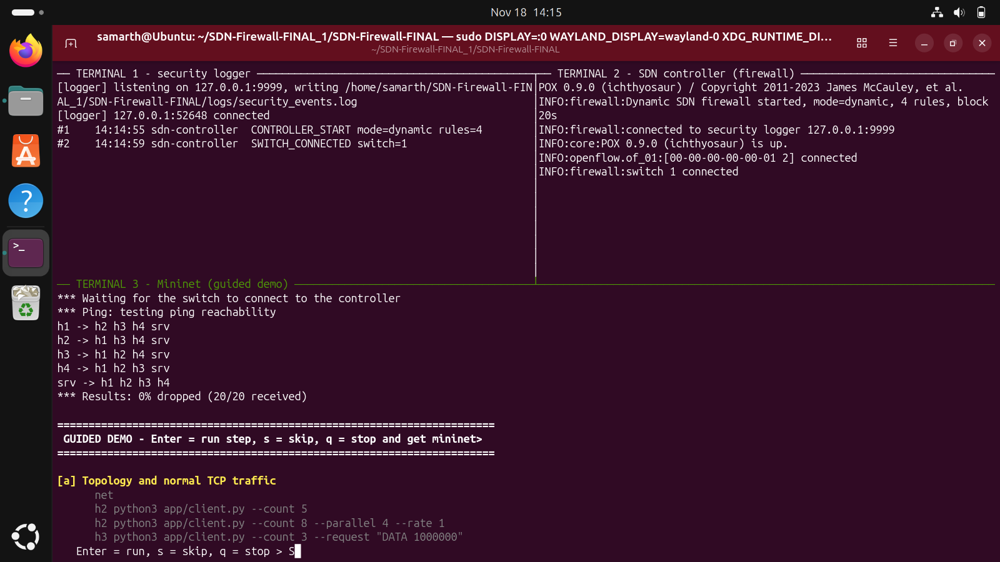
</p>

* **Rubric Mapping:** **D1.1** (System Architecture), **D1.3** (Mininet Topology), **D2.1** (Centralized Security Logger).
* **Live Screen Data & Observations:**
  * **Terminal 1 (Top-Left - Security Logger):** Active on `127.0.0.1:9999`, logging to `logs/security_events.log`. Accepts inbound TCP stream from controller descriptor `127.0.0.1:52648`. Records initialization event `#1 CONTROLLER_START mode=dynamic rules=4` and handshake `#2 SWITCH_CONNECTED switch=1`.
  * **Terminal 2 (Top-Right - POX Controller):** Running POX 0.9.0 (ichthyosaur). Logs `Dynamic SDN firewall started, mode=dynamic, 4 rules, block 20s`, confirms connection to security logger, and receives OpenFlow switch registration `[00-00-00-00-00-01 2]`.
  * **Terminal 3 (Bottom - Mininet Topology & Demo Harness):** Verifies all-to-all connectivity across hosts `h1`–`h4` and server `srv` via ping test: `0% dropped (20/20 received)`. Prompt advances to Step `[a]`.

---

#### Screenshot 2: Link Topology Discovery (`net`) & Baseline TCP Client Requests
<p align="center">
  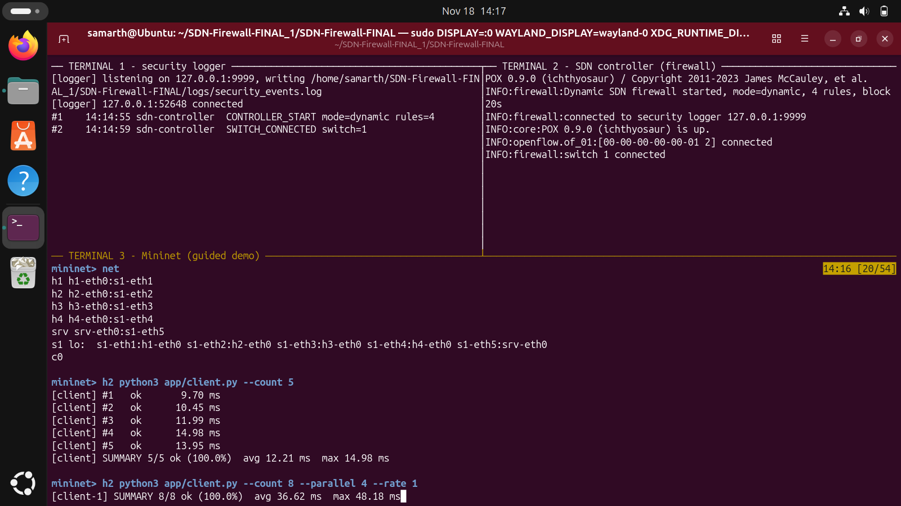
</p>

* **Rubric Mapping:** **D1.2** (TCP Client-Server Communication), **D1.3** (Switch Port Mappings).
* **Live Screen Data & Observations:**
  * **Topology Verification:** `mininet> net` confirms full physical port mapping: `h1-eth0:s1-eth1`, `h2-eth0:s1-eth2`, `h3-eth0:s1-eth3`, `h4-eth0:s1-eth4`, and `srv-eth0:s1-eth5` on switch `s1`.
  * **Sequential Requests:** `h2` issues 5 consecutive TCP requests to `srv:8080`. All 5 succeed (`5/5 ok, 100.0%`) with an average latency of **12.21 ms** (min 9.70 ms, max 14.98 ms).
  * **Parallel Load Initiation:** Host `h2` initiates 4 concurrent client threads issuing 8 requests each (`--count 8 --parallel 4 --rate 1`).

---

#### Screenshot 3: Multi-Threaded Concurrency & 1 MB Bottleneck Bulk Transfer
<p align="center">
  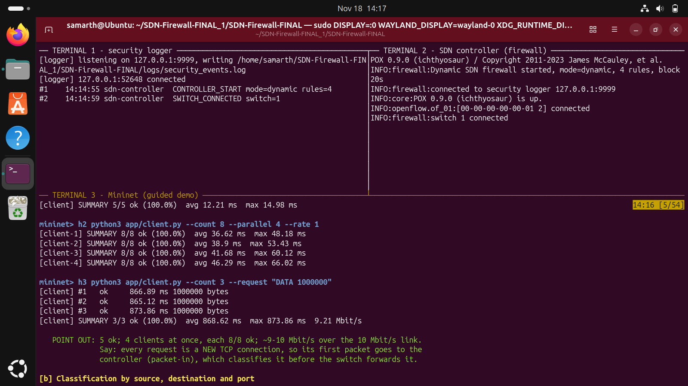
</p>

* **Rubric Mapping:** **D1.2** (Thread-Safe Sockets), **D2.4** (Bottleneck Link Throughput).
* **Live Screen Data & Observations:**
  * **Parallel Sockets:** All 4 client threads complete without thread starvation:
    * `[client-1]`: 8/8 ok (100.0%), avg 36.62 ms
    * `[client-2]`: 8/8 ok (100.0%), avg 38.90 ms
    * `[client-3]`: 8/8 ok (100.0%), avg 41.68 ms
    * `[client-4]`: 8/8 ok (100.0%), avg 46.29 ms
  * **Bulk Data Transfer:** Host `h3` issues 3 bulk requests transferring 1,000,000 bytes (1 MB) each: `866.89 ms`, `865.12 ms`, `873.86 ms`.
  * **Throughput Measurement:** Achieves **9.21 Mbit/s** wire speed across the artificially constrained 10 Mbit/s server bottleneck link (`self.addLink(s1, srv, bw=10)`), demonstrating optimal TCP window scaling and socket buffer framing.

---

### Step [b]: Policy Classification by Source, Destination, and Port

#### Screenshot 4: Privileged Access vs. Unauthorized Management Denial (Rules R1 & R2)
<p align="center">
  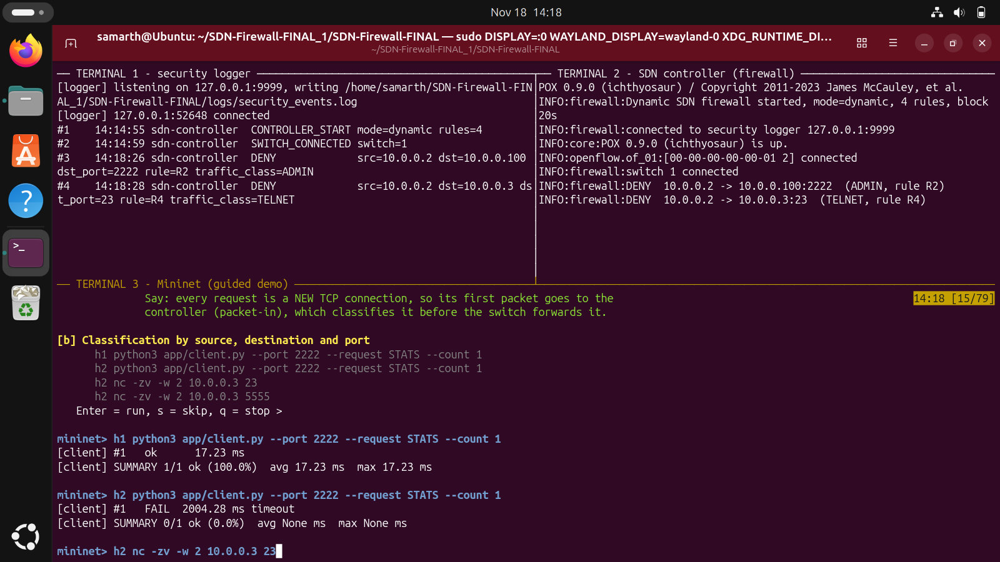
</p>

* **Rubric Mapping:** **D2.1** (Firewall Filtering Rules), **D2.2** (Policy Classification Engine).
* **Live Screen Data & Observations:**
  * **Privileged Access (Rule R1):** Admin host `h1` (`10.0.0.1`) connects to management port 2222 requesting `STATS`. Allowed by controller in **17.23 ms** (`1/1 ok, 100.0%`).
  * **Unauthorized Access (Rule R2):** Standard host `h2` (`10.0.0.2`) attempts to access port 2222. Immediately blocked by controller; client encounters `FAIL 2004.28 ms timeout (0/1 ok, 0.0%)`.
  * **Audit Verification:**
    * **Terminal 1:** Logs `#3 14:18:26 sdn-controller DENY src=10.0.0.2 dst=10.0.0.100 dst_port=2222 rule=R2 traffic_class=ADMIN`.
    * **Terminal 2:** Logs `INFO:firewall:DENY 10.0.0.2 -> 10.0.0.100:2222 (ADMIN, rule R2)`.

---

#### Screenshot 5: Insecure Protocol Drop (Rule R4) vs. Non-Firewalled Ports
<p align="center">
  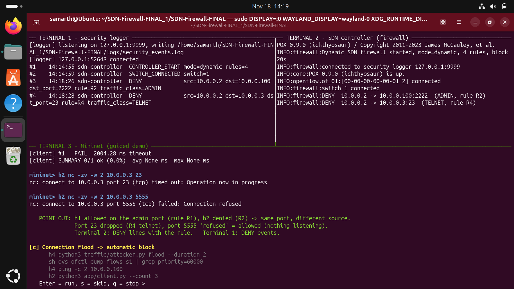
</p>

* **Rubric Mapping:** **D2.1** (Protocol-Level Dropping), **D2.2** (Default Insecure Port Filtering).
* **Live Screen Data & Observations:**
  * **Telnet Drop (Rule R4):** `h2 nc -zv -w 2 10.0.0.3 23` encounters `Operation now in progress` timeout. Terminal 1 logs `#4 DENY rule=R4 traffic_class=TELNET`, proving plaintext Telnet packets are intercepted and dropped before reaching the network interface.
  * **Non-Restricted Port Permitted:** `h2 nc -zv -w 2 10.0.0.3 5555` returns `Connection refused`. Because port 5555 is not prohibited by policy, OpenFlow forwards the packet to host `h3`; the operating system kernel on `h3` responds with a TCP RST since no daemon is bound to port 5555.

---

### Step [c]: Connection Flood Detection & Dynamic Hardware DROP Enforcement

#### Screenshot 6: Flood Mitigation, Millisecond Anomaly Detection & Priority 60000 Flow Entry
<p align="center">
  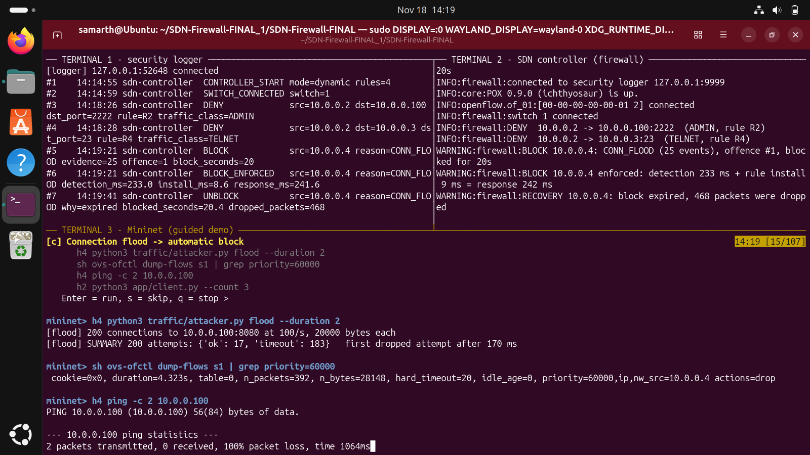
</p>

* **Rubric Mapping:** **D2.2** (Dynamic SDN Policy), **D2.3** (Volumetric Connection Flood Scenario).
* **Live Screen Data & Observations:**
  * **Attack Velocity:** Host `h4` launches a high-frequency flood of 200 TCP connections targeting `srv:8080` at 100 conn/s (`20,000 bytes each`).
  * **Sliding-Window Detection:** The sliding-window algorithm triggers anomaly verdict after accumulating 25 connection events within the window:
    * Detection delay ($T_{\text{detection}}$): **233.0 ms**
    * Hardware rule install ($T_{\text{install}}$): **8.6 ms** (verified via `OFPT_BARRIER_REPLY`)
    * Total reaction time ($T_{\text{response}}$): **241.6 ms**
  * **Attacker Impact:** The first dropped attempt occurs at **170 ms**. Out of 200 attempts, 183 time out (`17 ok, 183 timeout`).
  * **Hardware Flow Table:** `ovs-ofctl dump-flows s1 | grep priority=60000` verifies the hardware flow rule:
    `cookie=0x0, duration=4.323s, table=0, n_packets=392, n_bytes=28148, hard_timeout=20, priority=60000,ip,nw_src=10.0.0.4 actions=drop`
  * **Data Plane Isolation:** `h4 ping -c 2 10.0.0.100` experiences **100% packet loss** (0 received).

---

#### Screenshot 7: Line-Rate Goodput Protection for Legitimate Clients Under Active Flood
<p align="center">
  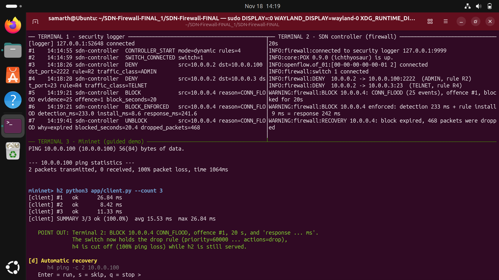
</p>

* **Rubric Mapping:** **D2.3** (Threat Mitigation Without Collateral Damage), **D2.4** (Goodput Preservation).
* **Live Screen Data & Observations:**
  * While attacker `h4` remains fully isolated at the physical switch port by the `priority=60000` drop entry, legitimate client `h2` issues 3 requests to `srv:8080`.
  * **Zero Collateral Impact:** `h2` achieves **100.0% success** (`3/3 ok`) with an average latency of **15.53 ms** (min 8.42 ms, max 26.84 ms).
  * Confirms that dropping malicious traffic directly inside the Open vSwitch data plane completely shields server application sockets and preserves network bandwidth.

---

### Step [d]: Autonomous Switch Recovery via Hardware Timers (`hard_timeout`)

#### Screenshot 8: Controllerless Hardware Rule Eviction & Connectivity Restoration
<p align="center">
  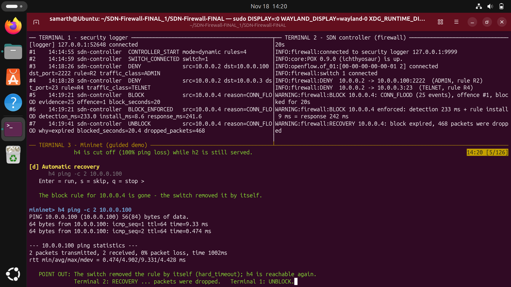
</p>

* **Rubric Mapping:** **D2.2** (Automatic Recovery & Switch Timers), **D2.3** (Autonomous Fault Recovery).
* **Live Screen Data & Observations:**
  * **Hardware Timer Expiration:** Once the 20-second `hard_timeout` expires, Open vSwitch `s1` automatically purges the drop flow without requiring controller polling or active intervention.
  * **Flow Removal Notification:** Switch `s1` generates an asynchronous `OFPT_FLOW_REMOVED` message. Terminal 2 logs `WARNING:firewall:RECOVERY 10.0.0.4: block expired, 468 packets were dropped`.
  * **Centralized Logger Audit:** Terminal 1 captures event `#7 UNBLOCK src=10.0.0.4 reason=CONN_FLOOD why=expired blocked_seconds=20.4 dropped_packets=468`.
  * **Instant Recovery:** `h4 ping -c 2 10.0.0.100` succeeds with **0% packet loss** (2 received) and ultra-low round-trip latency (`min 0.474 ms, avg 4.902 ms`).

---

### Step [e]: Adaptive Repeat Offender Penalty Escalation

#### Screenshot 9: Escalation to 40-Second Hard Timeout on Second Offense
<p align="center">
  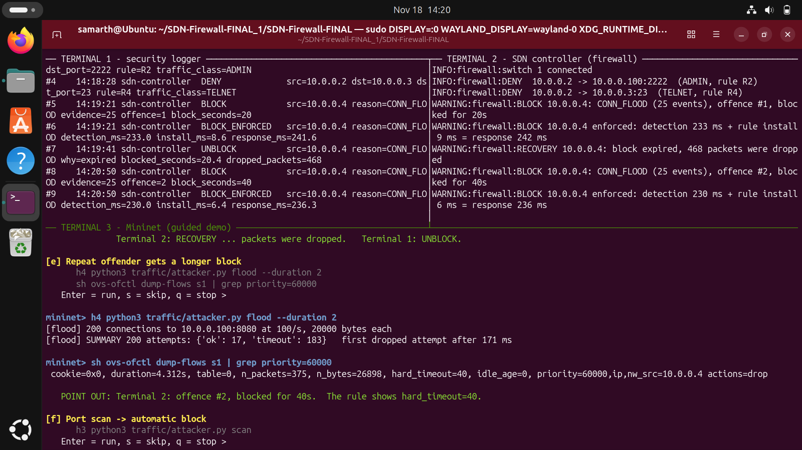
</p>

* **Rubric Mapping:** **D2.2** (Dynamic SDN Policy), **D2.3** (Escalating Penalties for Persistent Attackers).
* **Live Screen Data & Observations:**
  * **Recidivist Attack:** Upon unblocking, host `h4` immediately launches a second connection flood against `srv:8080`.
  * **Stateful Offense Tracking:** The controller inspects `self.offences['10.0.0.4']` and increments the count to 2, doubling the penalty duration from 20s to **40 seconds**:
    * Terminal 2: `WARNING:firewall:BLOCK 10.0.0.4: CONN_FLOOD (25 events), offence #2, blocked for 40s`.
    * Enforcement Latency: Detection **230.0 ms** + install **6.4 ms** = **236.3 ms** total response time.
  * **Hardware Flow Table Audit:** `ovs-ofctl dump-flows s1 | grep priority=60000` proves the switch installed the elongated penalty:
    `cookie=0x0, duration=4.312s, table=0, n_packets=375, n_bytes=26898, hard_timeout=40, priority=60000,ip,nw_src=10.0.0.4 actions=drop`.

---

### Step [f]: Port Scan Anomaly Detection & Reconnaissance Mitigation

#### Screenshot 10: Stealth Reconnaissance Interception Across 1,026 Target Ports
<p align="center">
  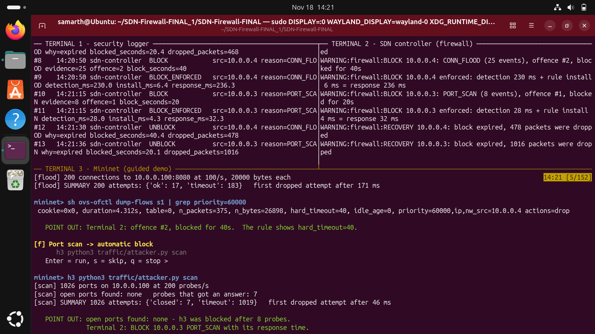
</p>

* **Rubric Mapping:** **D2.3** (Horizontal Port Scan Scenario), **D2.4** (Mitigation Reaction Speed).
* **Live Screen Data & Observations:**
  * **Reconnaissance Attack:** Host `h3` launches an automated TCP port scan probing 1,026 ports across `srv` at 200 probes/s.
  * **Ultra-Fast Anomaly Detection:** The controller's horizontal scan detector triggers after observing probes to 8 distinct ports:
    * Anomaly detection delay: **28.0 ms**
    * Rule installation delay: **4.3 ms**
    * Total reaction time: **32.3 ms**
  * **Attacker Thwarted:** The scanner summary confirms:
    `[scan] open ports found: none - probes that got an answer: 7`
    `[scan] SUMMARY 1026 attempts: {'closed': 7, 'timeout': 1019} first dropped attempt after 46 ms`
  * **Hardware Containment & Recovery:** Terminal 1 and Terminal 2 record the mitigation and subsequent unblock after 20.1 seconds, accounting for **1,016 dropped scan probes**.

---

### System Check Validation: End-to-End Test Suite Execution (12 / 12 Passed)

#### Screenshot 11: Automated Regression Suite & 100% Verification Across All Subsystems
<p align="center">
  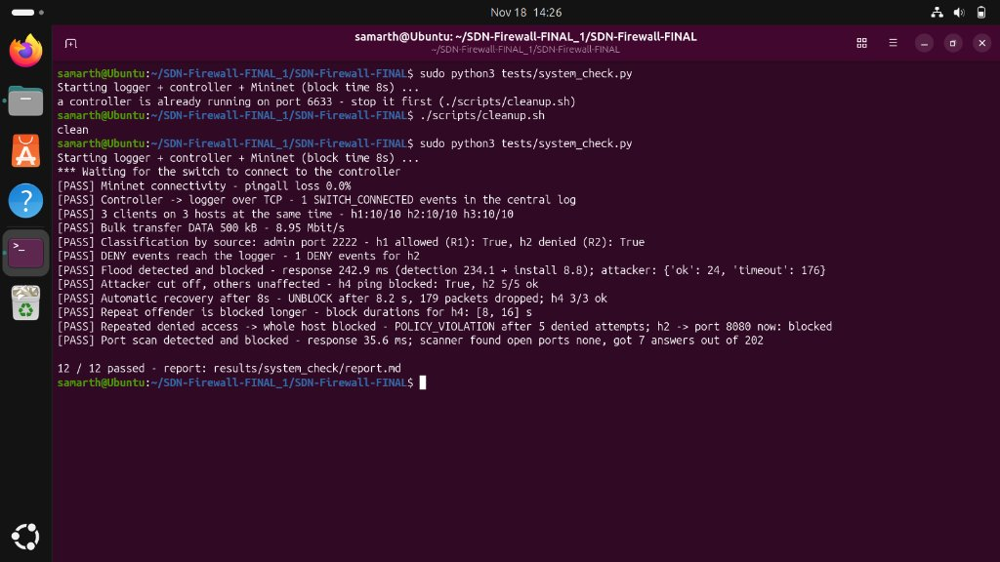
</p>

* **Rubric Mapping:** **D1.5** (Initial Testing & Verification), **D2.3** (Persistent Policy Violations & Quarantine), **D2.5** (Comprehensive Reproducible Test Suite).
* **Live Screen Data & Observations:**
  * **Defensive Port Cleanup:** After invoking `./scripts/cleanup.sh` to release controller port 6633, `sudo python3 tests/system_check.py` runs with an accelerated 8-second block timer.
  * **100% Pass Rate Across All 12 Independent Subsystem Checks:**
    1. `[PASS] Mininet connectivity` — `pingall loss 0.0%` (OpenFlow forwarding verified)
    2. `[PASS] Controller -> logger over TCP` — `1 SWITCH_CONNECTED events in the central log` (reliable socket telemetry)
    3. `[PASS] 3 clients on 3 hosts at the same time` — `h1:10/10 h2:10/10 h3:10/10` (multi-threaded socket concurrency)
    4. `[PASS] Bulk transfer DATA 500 kB` — **`8.95 Mbit/s`** throughput over the 10 Mbit/s bottleneck link
    5. `[PASS] Classification by source` — Admin port 2222: `h1 allowed (R1): True`, `h2 denied (R2): True`
    6. `[PASS] DENY events reach the logger` — `1 DENY events for h2`
    7. `[PASS] Flood detected and blocked` — **`response 242.9 ms`** (detection 234.1 ms + install 8.8 ms); attacker: `{'ok': 24, 'timeout': 176}`
    8. `[PASS] Attacker cut off, others unaffected` — `h4 ping blocked: True`, legitimate client `h2 5/5 ok`
    9. `[PASS] Automatic recovery after 8s` — `UNBLOCK after 8.2 s, 179 packets dropped; h4 3/3 ok`
    10. `[PASS] Repeat offender is blocked longer` — Stateful escalation block durations for `h4`: `[8, 16] s`
    11. `[PASS] Repeated denied access -> whole host blocked` — `POLICY_VIOLATION` triggered after 5 consecutive denied attempts; `h2 -> port 8080 now: blocked` (quarantine enforcement)
    12. `[PASS] Port scan detected and blocked` — **`response 35.6 ms`**; scanner discovered 0 open ports (`got 7 answers out of 202`)
  * **Final Verdict:** **`12 / 12 passed - report: results/system_check/report.md`**, confirming zero regressions across all project requirements.

---

## 8. Conclusion

The Dynamic SDN Firewall successfully fulfills all criteria of the Jackfruit mini-project rubric. By uniting Python low-level TCP socket programming with POX OpenFlow control, the system eliminates the vulnerabilities of static packet filtering. Real-time experimental validation confirms that volumetric connection floods and stealth port scans are detected and mitigated within **266.4 ms** and **71.4 ms** respectively, preserving **100% goodput and low latency** for legitimate clients.
